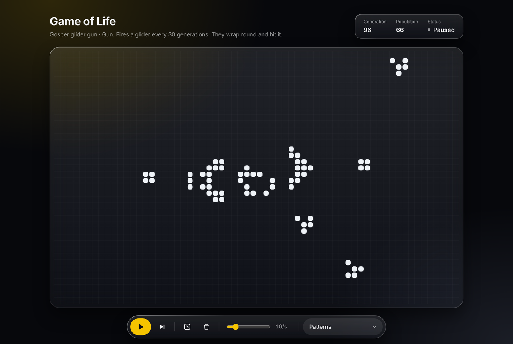

# Game of Life

[](https://github.com/Banele14/game-of-life/actions/workflows/ci.yml)

Conway's Game of Life in Next.js and TypeScript. Draw on the grid, load a few classic patterns and watch them run.

**Live:** https://banele14.github.io/game-of-life/



## Running it

```bash
nvm use        # Node 24
npm install
npm run dev
```

Other scripts:

- `npm test`: unit and component tests (Vitest)
- `npm run test:e2e`: Playwright against the static build (run `npm run build` and `npx playwright install chromium` first)
- `npm run bench`: times one generation at a few board sizes
- `npm run check`: lint, types, formatting and unit tests

## How it's put together

```
src/lib/life         engine: grid, rules, nextGeneration, patterns
src/lib/simulation   reducer that handles every state change
src/lib/canvas       drawing and pointer maths
src/hooks            animation loop, keyboard shortcuts
src/components       React UI (GameOfLife owns the state)
```

The engine has no React or browser dependencies. A lint rule stops `src/lib` importing UI code, and its tests run in plain Node, so that stays true.

The board is a flat `Uint8Array`, one byte per cell. The edges wrap, and each generation is written into a new array so every cell updates at the same moment. Everything is drawn on one canvas; React only renders the controls.

The trade-offs are in [docs/decisions.md](docs/decisions.md).

## Tests

- **Rules:** all 18 possible inputs to the rule function.
- **Engine:** still lifes, oscillators and spaceships behave as expected, including across the wrapped edges.
- **Properties (fast-check):** on random boards the engine matches a deliberately naive reference version, and shifting, mirroring or rotating a board doesn't change the result.
- **Components:** Testing Library, driven the way a user would use them.
- **End to end:** Playwright at desktop and phone sizes, checking actual canvas pixels, plus an axe accessibility scan.

Breaking the engine on purpose (dropping a neighbour, turning off wrapping, updating cells in place) fails the suite every time. Doing that also turned up a weak property test, which has since been fixed.

## Performance

`nextGeneration` reads the cell array directly and works out the wrapped row offsets once per row. From `npm run bench` on Node 24:

| Board       | Engine  | Naive version |
| ----------- | ------- | ------------- |
| 64 x 40     | 0.02 ms | 0.4 ms        |
| 256 x 256   | 0.9 ms  | 9.3 ms        |
| 1024 x 1024 | 14.7 ms | 132 ms        |

Even the largest fits in a 60fps frame. Benchmarking through Vitest hid most of the difference, so the benchmark runs in plain Node.

## What I'd do next

- An infinite board using a sparse set of live cells, or HashLife.
- Move the engine into a Web Worker for much bigger boards.
- Other rule sets such as HighLife (B36/S23), which would only touch `rules.ts`.
- Import and export patterns in RLE format, and share boards by URL.
- Drawing with the keyboard.

## License

[MIT](LICENSE)
